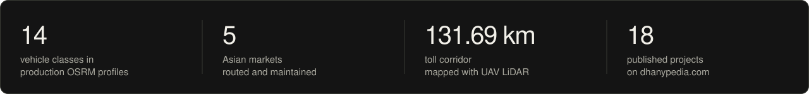
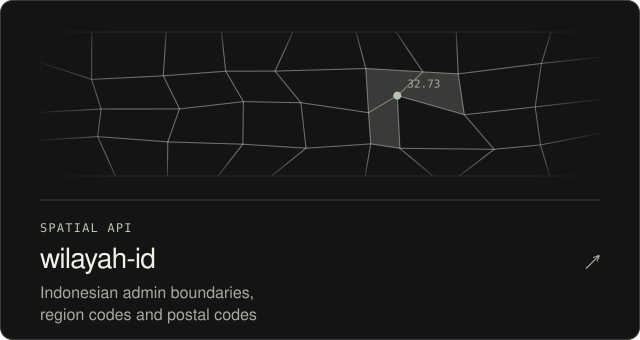
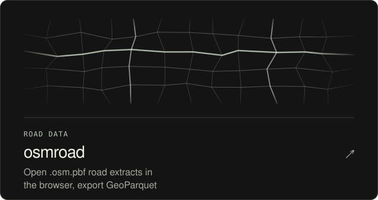
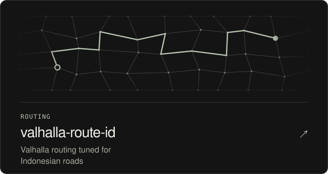
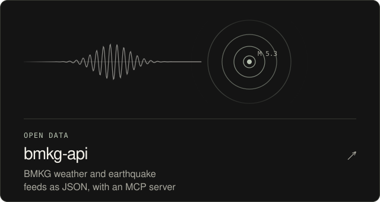
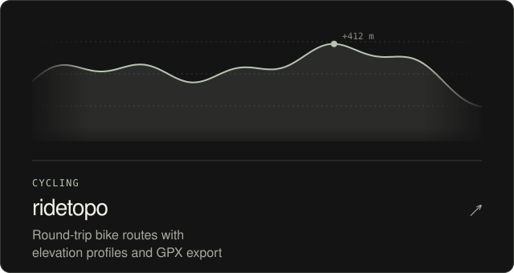
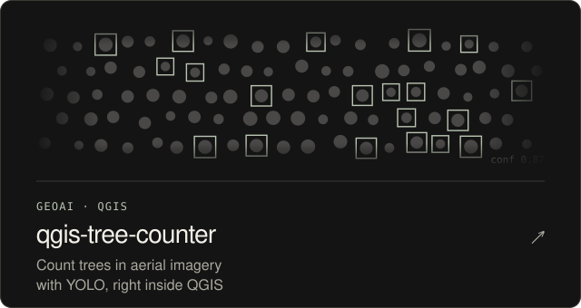

<picture><source media="(prefers-color-scheme: dark)" srcset="./assets/header-dark.svg" /><source media="(prefers-color-scheme: light)" srcset="./assets/header-light.svg" /></picture>

I build routing engines, WebGIS applications, and spatial data systems for mobility and infrastructure, from UAV LiDAR on the ground to OSRM routing profiles in production. For about two years I ran a mobility company's GIS, routing and map tooling as a one-person function.

[dhanypedia.com](https://www.dhanypedia.com) · [CV](https://www.dhanypedia.com/cv) · [LinkedIn](https://linkedin.com/in/dhanyyudi) · [Email](mailto:dhanyyudi.prasetyo@gmail.com)

<picture><source media="(prefers-color-scheme: dark)" srcset="./assets/numbers-dark.svg" /><source media="(prefers-color-scheme: light)" srcset="./assets/numbers-light.svg" /></picture>

### Open source

  <a href="https://github.com/dhanyyudi/wilayah-id"><picture><source media="(prefers-color-scheme: dark)" srcset="./assets/cards/wilayah-id-dark.svg" /><source media="(prefers-color-scheme: light)" srcset="./assets/cards/wilayah-id-light.svg" /></picture></a>
  <a href="https://github.com/dhanyyudi/osmroad"><picture><source media="(prefers-color-scheme: dark)" srcset="./assets/cards/osmroad-dark.svg" /><source media="(prefers-color-scheme: light)" srcset="./assets/cards/osmroad-light.svg" /></picture></a>

  <a href="https://github.com/dhanyyudi/valhalla-route-id"><picture><source media="(prefers-color-scheme: dark)" srcset="./assets/cards/valhalla-route-id-dark.svg" /><source media="(prefers-color-scheme: light)" srcset="./assets/cards/valhalla-route-id-light.svg" /></picture></a>
  <a href="https://github.com/dhanyyudi/bmkg-api"><picture><source media="(prefers-color-scheme: dark)" srcset="./assets/cards/bmkg-api-dark.svg" /><source media="(prefers-color-scheme: light)" srcset="./assets/cards/bmkg-api-light.svg" /></picture></a>

  <a href="https://github.com/dhanyyudi/ridetopo"><picture><source media="(prefers-color-scheme: dark)" srcset="./assets/cards/ridetopo-dark.svg" /><source media="(prefers-color-scheme: light)" srcset="./assets/cards/ridetopo-light.svg" /></picture></a>
  <a href="https://github.com/dhanyyudi/qgis-tree-counter"><picture><source media="(prefers-color-scheme: dark)" srcset="./assets/cards/qgis-tree-counter-dark.svg" /><source media="(prefers-color-scheme: light)" srcset="./assets/cards/qgis-tree-counter-light.svg" /></picture></a>

Case studies for client work, including the GeoMatra GIS platform and the Trans Sumatra Toll Road digital twin, live at [dhanypedia.com/projects](https://www.dhanypedia.com/projects).

### Toolbox

**Routing** · OSRM (Lua profiles), Valhalla, network analysis 
**Spatial data** · PostGIS, QGIS, ArcGIS, LiDAR and photogrammetry 
**Web mapping** · MapLibre GL, CesiumJS, Leaflet, OGC services 
**Engineering** · Python, TypeScript, Go, Docker, Cloudflare
